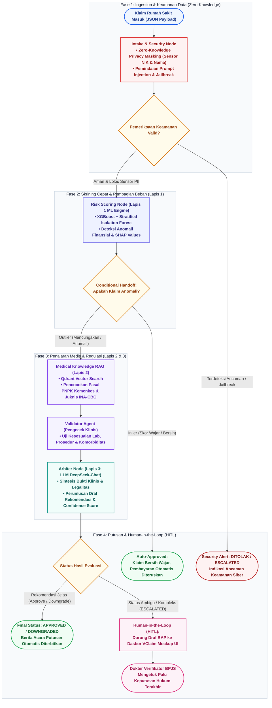

# Workflow Sistem GARDA-JKN (LangGraph StateGraph) - Tema Putih (Word Document & Clean Light Mode)

Diagram ini mengilustrasikan alur kerja penanganan klaim BPJS Kesehatan secara *deterministik* dan aman, yang diorkestrasi menggunakan **LangGraph StateGraph**.

> **Khusus Dokumen & Proposal:** Palet warna diagram ini telah dioptimalkan khusus untuk **latar belakang putih (White Background)** agar tampak bersih, elegan, profesional, dan menyatu sempurna saat dimasukkan ke dalam Microsoft Word atau dokumen cetak resmi.

---

## 📊 Diagram Mermaid (Versi Light Theme / White Background)

Salin kode Mermaid di bawah ini langsung ke:
- **GitHub / Markdown Viewer**: Otomatis ter-render sebagai diagram bersih dengan aksen warna korporat.
- **Draw.io**: Buka [app.diagrams.net](https://app.diagrams.net), lalu pilih menu **Arrange** > **Insert** > **Advanced** > **Mermaid**, tempel kode ini, dan klik **Insert**.

---

## 🖼️ File Gambar Siap Pakai untuk Microsoft Word

Kami juga telah merender diagram beresolusi tinggi (Retina quality 2x) dengan latar belakang putih murni yang siap disisipkan ke dokumen Word:
- Lokasi file: `docs/evidence/plot_workflow_system.png`
- File ini juga **sudah otomatis disematkan ke dalam proposal resmi Word** Anda di:
  `docs/Proposal_Healthkathon_2026_GARDA_JKN.docx` (Bagian 3).

---

## 🎨 Palet Warna Ramah Latar Belakang Putih

| Komponen | Warna Latar (Fill) | Warna Garis (Stroke) | Warna Teks | Keterangan |
| :--- | :--- | :--- | :--- | :--- |
| **Start / Input** | `#EFF6FF` (Ice Blue) | `#2563EB` (Royal Blue) | `#1E3A8A` (Deep Blue) | Kontras tinggi, bersih |
| **Security Node** | `#FEF2F2` (Soft Red) | `#DC2626` (Red) | `#991B1B` (Deep Red) | Peringatan keamanan |
| **Risk Scoring ML** | `#EEF2FF` (Soft Indigo) | `#4F46E5` (Indigo) | `#312E81` (Deep Indigo) | Nuansa komputasi data |
| **Decision Gates** | `#FFFBEB` (Soft Amber) | `#D97706` (Amber) | `#92400E` (Deep Amber) | Titik percabangan |
| **RAG Knowledge** | `#F5F3FF` (Soft Violet) | `#7C3AED` (Violet) | `#5B21B6` (Deep Violet) | Basis pengetahuan |
| **LLM Arbiter** | `#F0FDFA` (Soft Teal) | `#0D9488` (Teal) | `#115E59` (Deep Teal) | Penalaran AI |
| **Success / Approved** | `#F0FDF4` (Soft Mint) | `#16A34A` (Green) | `#166534` (Deep Green) | Status lolos audit |
| **Human-in-the-Loop** | `#FDF2F8` (Soft Pink) | `#DB2777` (Magenta) | `#9D174D` (Deep Magenta) | Intervensi dokter manusia |
| **Subgraph Boxes** | `#F8FAFC` (Slate Tint) | `#CBD5E1` (Slate Border) | `#0F172A` (Slate Header) | Kotak pembungkus fase |
