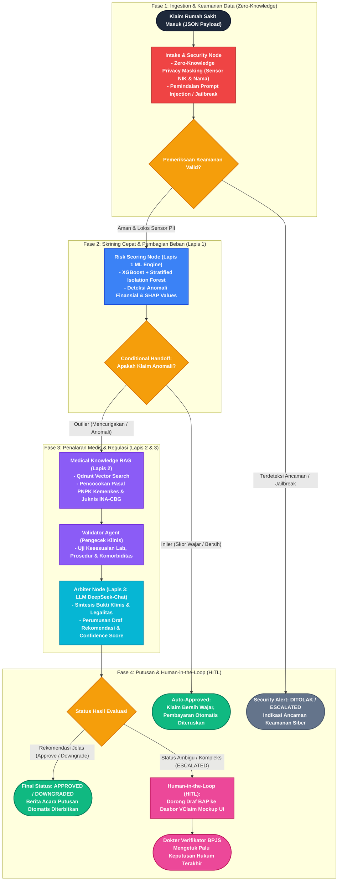

# Workflow Sistem GARDA-JKN (LangGraph StateGraph)

Diagram ini mengilustrasikan alur kerja penanganan klaim BPJS Kesehatan secara *deterministik* dan aman, yang diorkestrasi menggunakan **LangGraph StateGraph**.

---

## 📊 Diagram Mermaid (Kompatibel dengan Draw.io & GitHub)

Salin kode Mermaid di bawah ini langsung ke:
- **GitHub / Markdown Viewer**: Otomatis ter-render sebagai diagram visual.
- **Draw.io**: Buka [app.diagrams.net](https://app.diagrams.net), lalu pilih menu **Arrange** > **Insert** > **Advanced** > **Mermaid**, tempel kode ini, dan klik **Insert**.

---

## 🔍 Penjelasan Tiap Komponen Alur

1. **Intake & Security Node (Fase 1)**
   - **Zero-Knowledge Privacy Masking**: Sebelum data menyentuh mesin ML atau Cloud LLM, data identitas pribadi (PII) seperti NIK dan Nama Pasien disamarkan sesuai amanat UU PDP No. 27/2022.
   - **Prompt Injection Defense**: Memeriksa kolom `catatan_klinis` dan diagnosis dari teks eksploitatif (seperti *"ignore previous instructions"*). Jika ada serangan, proses langsung dihentikan demi integritas sistem.

2. **Risk Scoring Node (Lapis 1 - XGBoost)**
   - Melakukan evaluasi statistik berkecepatan tinggi (<100ms) menggunakan model ensemble *Stratified Isolation Forest* dan *XGBoost*.
   - Menghasilkan probabilitas anomali finansial dan alasan *SHAP* (misal: rasio biaya harian berlebih, durasi rawat janggal).

3. **Conditional Handoff (Percabangan Cerdas)**
   - **Inlier (Klaim Wajar)**: 70-80% klaim rutin langsung dialihkan ke **Auto-Approve**, menghemat biaya token API dan memangkas antrean faskes.
   - **Outlier (Klaim Mencurigakan)**: Diteruskan ke pipeline penalaran medis mendalam (RAG & LLM).

4. **Medical Knowledge RAG & Validator Agent (Lapis 2)**
   - **Qdrant Vector DB**: Menarik dokumen Pedoman Nasional Pelayanan Kedokteran (PNPK) resmi Kemenkes RI yang relevan dengan diagnosis dan tindakan pasien.
   - **Validator Agent**: Memvalidasi kesesuaian klinis (misalnya kriteria AKI KDIGO pada stroke, atau batas LOS pada STEMI).

5. **Arbiter Node (Lapis 3 - LLM DeepSeek-Chat)**
   - Mengintegrasikan temuan Lapis 1 dan Lapis 2 untuk menyusun pertimbangan medis formal secara terstruktur.
   - Mengeluarkan rekomendasi status:
     - `APPROVED`: Terbukti memenuhi indikasi medis.
     - `DOWNGRADED`: Ditemukan indikasi upcoding tingkat severity (misal Severity III diturunkan ke Severity II karena komorbiditas tidak terbukti).
     - `ESCALATED`: Temuan anomali kompleks atau bukti tidak lengkap.

6. **Human-in-the-Loop (HITL) pada Dasbor VClaim**
   - Klaim ambigu (`ESCALATED`) tidak ditolak sepihak oleh AI. 
   - Draf Berita Acara Pemeriksaan (BAP) beserta ringkasan bukti klinis disajikan di antarmuka Next.js VClaim.
   - **Dokter Verifikator Manusia** tetap memegang kendali penuh sebagai pemutus hukum (*final adjudicator*).

---

## 💡 Cara Import ke Draw.io

1. Buka [Draw.io / diagrams.net](https://app.diagrams.net).
2. Klik menu **Arrange** di bar navigasi atas.
3. Pilih **Insert** > **Advanced** > **Mermaid**.
4. Salin seluruh blok kode Mermaid di atas (mulai dari `flowchart TD` sampai baris terakhir).
5. Klik tombol **Insert**.
6. Diagram akan langsung dikonversi menjadi elemen kotak, garis, dan ikon yang dapat digeser, diwarnai, atau diekspor ke PNG/PDF/SVG untuk kebutuhan proposal dan slide presentasi Healthkathon.
