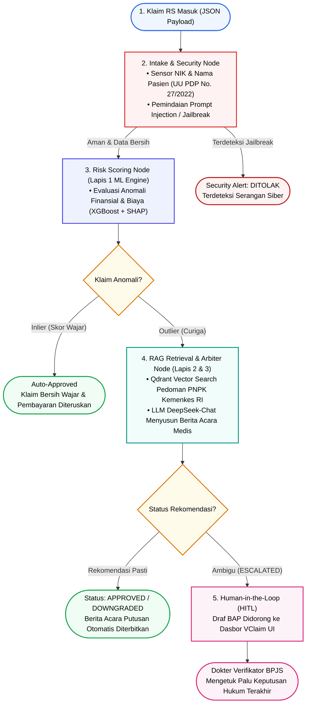

# Workflow Sistem GARDA-JKN (Ringkas, To The Point, & Font Hitam)

Diagram alur kerja penanganan klaim BPJS Kesehatan ini telah disederhanakan agar **to the point**, mudah dipahami dalam sekali lihat, dengan **seluruh font berwarna hitam pekat (`#000000`)** dan bebas dari kotak bertingkat yang membingungkan.

---

## 📊 Diagram Mermaid (Versi To The Point & Font Hitam)

---

## 🖼️ File Gambar PNG untuk Microsoft Word
File gambar PNG resolusi tinggi siap pakai telah diperbarui di:
- **File:** `docs/evidence/plot_workflow_system.png`
- **Di Word:** Pilih menu **Insert > Pictures > This Device** dan pilih file tersebut.
- **Proposal Word Otomatis:** Sudah disematkan ke [`docs/Proposal_Healthkathon_2026_GARDA_JKN.docx`](file:///home/wmaulanaaishq/projects/bpjs_2025/docs/Proposal_Healthkathon_2026_GARDA_JKN.docx) pada Bagian 3.
